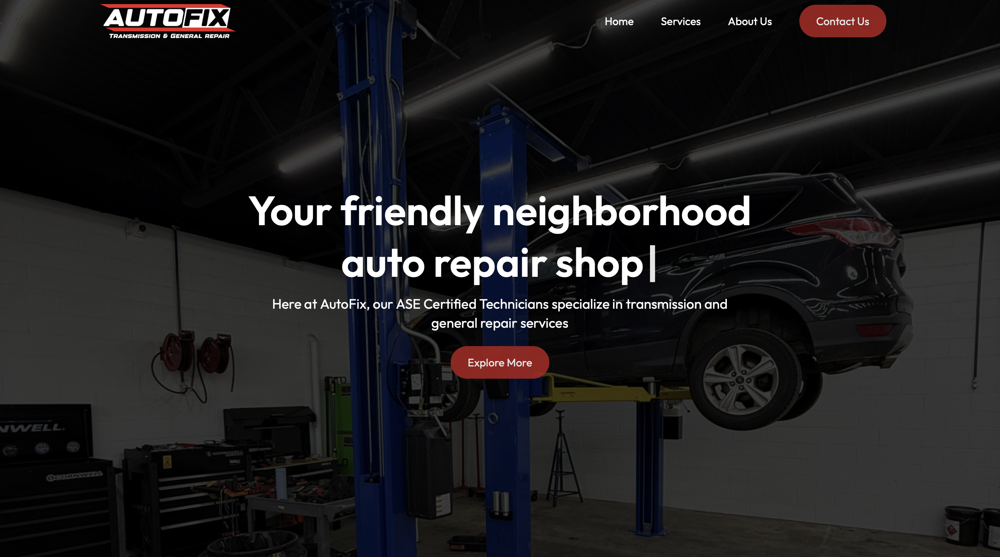
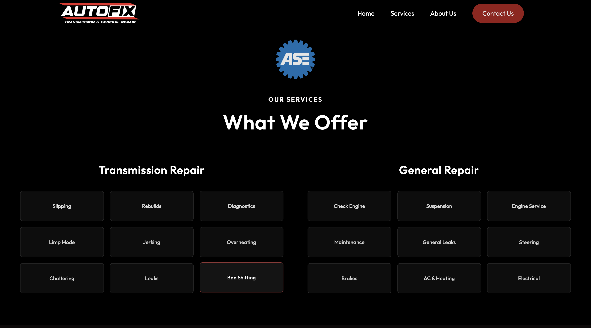
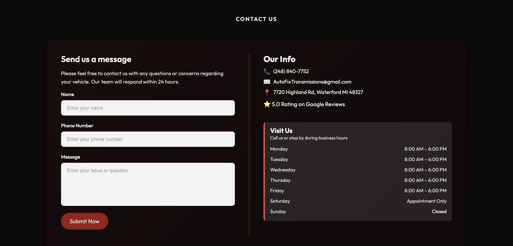

# Autofix Transmissions & General Repair

Website for **Autofix Transmissions & General Repair**, an automotive repair shop based in Waterford, Michigan. The site gives customers a quick way to learn about the shop's services and get in touch!

**Live site:** https://www.autofixtransmissions.com

## About

Autofix specializes in transmission repair and general automotive service. This project is the shop's public-facing website, built to be fast, mobile-friendly, and easy for local customers to use.

## Features

<!-- Edit this list to match what the site actually includes. -->
- Overview of services (transmission repair, general repair, and more)
- Shop location and business hours
- Contact information and calls to action
- Responsive layout for phones, tablets, and desktops.

## Tech Stack

- [React](https://react.dev/)
- [Vite](https://vite.dev/) for development and builds
- [ESLint](https://eslint.org/) for linting
- JavaScript, HTML, CSS

## License

All rights reserved. The Autofix name, branding, and content belong to their respective owner. The code is shared for portfolio purposes only and may not be copied or redistributed without permission.
